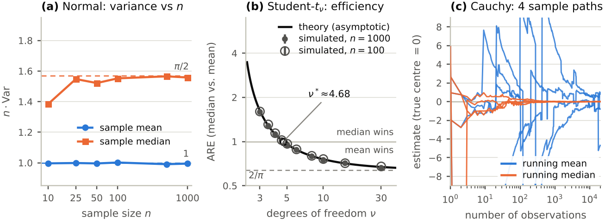

# Sample Mean vs. Sample Median: Efficiency, Robustness and a Monte Carlo Study

MT3194 *Statistical Inference* group project · **Group 11**: Bhumika, Parth, Satyam, Sriharipriya, Vishwabharathi

> How well do the sample mean and the sample median estimate the centre of a distribution when the data are not normal?
> We derive their variances and compare them with the Cramér–Rao bound, study robustness through influence functions and breakdown points,
> run a Monte Carlo study under heavy tails and outliers, and check the predictions on class data.

**Project website:** <https://parthsarda5.github.io/mean-vs-median/> (see [Publishing the website](#publishing-the-website)) ·
**Simulation report (2 pages):** [`report/simulation_report.pdf`](report/simulation_report.pdf)



## Headline results

ARE = Var(mean) / Var(median); values above 1 favour the median.

| Question | Answer |
|---|---|
| How much does the median lose at the normal model? | ARE $=2/\pi\approx0.637$: about 57 % more data for the same precision (simulated 0.638 at $n=1000$) |
| How heavy must the tails be before the median wins? | Student-$t$ with $\nu\le4$; crossover at $\nu^*\approx4.68$ (ARE 1.125 at $\nu=4$, 0.961 at $\nu=5$) |
| Cauchy data? | The mean never converges (same law as one observation); the median has efficiency $8/\pi^2\approx0.81$ against the Cramér–Rao bound |
| Outliers? | 10 % scale contamination already makes the two equally good (ARE 1.00); 10 % gross outliers make the mean's MSE 28 times the median's |
| Best all-round choice? | Huber and Hodges–Lehmann lose only 6–7 % at the normal and beat both mean and median under moderate tails |
| Breakdown point ($n=101$) | mean 1 observation · 10 % trimmed mean 11 · Hodges–Lehmann 30 (29.3 % in theory) · median and Huber 51 (maximum) |

## Components

| Component | Folder | Owner | Status |
|---|---|---|---|
| **Theory**: variances, Cramér–Rao bound, ARE for normal, $t_\nu$, Laplace, Cauchy | [`theory/`](theory) | to be filled in | summary on the website; numerical checks in `simulation/tests/test_theory.py` |
| **Robustness**: influence functions, breakdown points, Tukey contamination | [`robustness/`](robustness) | to be filled in | summary on the website; evidence in `simulation/results/data/{sensitivity,breakdown}.csv` |
| **Simulation**: Monte Carlo study, figures, tables, 2-page report | [`simulation/`](simulation), [`report/`](report) | Parth | complete: code, data, 35 tests, report |
| **Application**: ARE estimated from class data, validated by bootstrap | [`application/`](application) | to be filled in | method planned; results to be added |

## Repository layout

```
mean-vs-median/
├── README.md                  this file
├── Makefile                   make test | sim | report | site | all
├── requirements.txt
├── theory/  robustness/  application/     one README per component (scope, status, hand-over notes)
├── simulation/
│   ├── README.md              design, results, how to run, method notes
│   ├── run_all.py             runs every experiment, then figures and tables
│   ├── mvm/                   the package: distributions, estimators, engine, theory, experiments, plotting, tables
│   ├── tests/                 35 unit and statistical tests
│   └── results/               data/ (CSV), figures/ (PDF + PNG), summary_*.md
├── report/                    simulation_report.tex / .pdf, auto-generated tables/ and numbers.tex
├── docs/                      the GitHub Pages website (index.html + assets/)
└── tools/                     build_site.py and site_template.html
```

## Quick start

```bash
git clone https://github.com/ParthSarda5/mean-vs-median.git
cd mean-vs-median
pip install -r requirements.txt     # Python >= 3.10
make test                           # 35 tests, about 5 s
make sim                            # full study (B = 100 000 per cell), about 3-4 min on 2 cores
make report                         # compile the 2-page report (needs LaTeX)
make site                           # rebuild docs/index.html from the saved results
```

The committed results were produced with master seed 20261110; an independent re-run reproduces them byte-for-byte.
`make quick` runs the whole pipeline with about 20× fewer replications into `simulation/results_quick/` as a smoke test.
Details, output-file descriptions and method notes: [`simulation/README.md`](simulation/README.md).

## Publishing the website

The site is a single static page in [`docs/`](docs) (no build step needed on GitHub). Push the repository, then on GitHub:
**Settings → Pages → Build and deployment → Source: *Deploy from a branch* → Branch: `main`, folder `/docs` → Save.**
After a minute it is live at `https://<user>.github.io/<repository>/`. Equations are typeset with MathJax loaded from a CDN, so the page needs an internet connection to show them.
To change the repository link used on the site, edit `REPO` in `tools/build_site.py` and run `make site`.

## References

* Tukey (1960). *A survey of sampling from contaminated distributions.*
* Huber (1964). *Robust estimation of a location parameter.* Ann. Math. Statist. 35, 73–101.
* Hodges & Lehmann (1963). *Estimates of location based on rank tests.* Ann. Math. Statist. 34, 598–611.
* Hodges & Lehmann (1967). *On medians and quasi medians.* J. Amer. Statist. Assoc. 62, 926–931.
* Andrews et al. (1972). *Robust Estimates of Location: Survey and Advances.* Princeton University Press.
* Hampel, Ronchetti, Rousseeuw & Stahel (1986). *Robust Statistics: The Approach Based on Influence Functions.* Wiley.
* Huber & Ronchetti (2009). *Robust Statistics*, 2nd ed. Wiley.
* van der Vaart (1998). *Asymptotic Statistics.* Cambridge University Press.
* Casella & Berger (2002). *Statistical Inference*, 2nd ed.
* Morris, White & Crowther (2019). *Using simulation studies to evaluate statistical methods.* Stat. Med. 38, 2074–2102.
