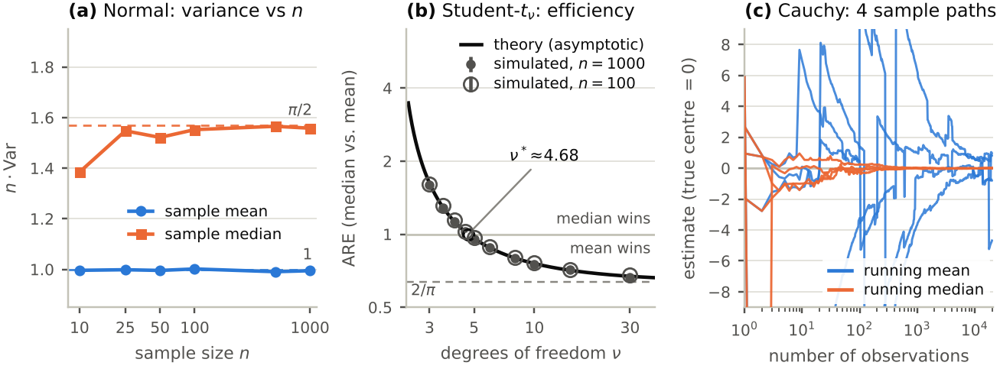
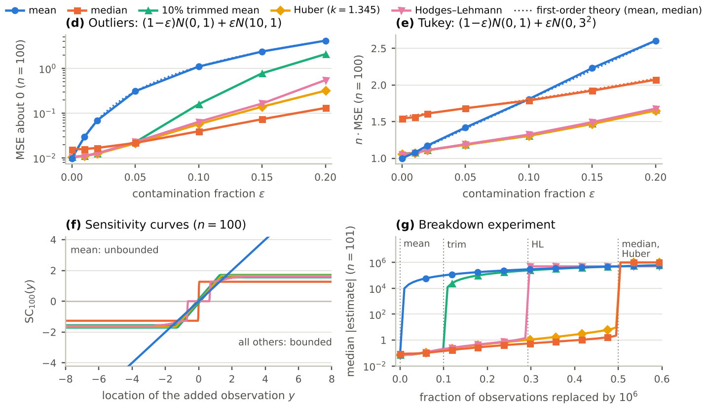

# Simulation component

Monte Carlo study of the **sample mean** and the **sample median**, plus three compromise estimators, under normal, heavy-tailed and contaminated data.
It implements the *Simulation* section of the group proposal: settings, metrics, the Cauchy running-estimate experiment, the breakdown experiment,
sensitivity curves and the comparator estimators. Everything quoted in the two-page report ([`../report/simulation_report.pdf`](../report/simulation_report.pdf)) is generated from the files in this folder.




## Study design

| Item | Setting |
|---|---|
| **Estimators** | sample mean, sample median (main grid); 10 % trimmed mean, Huber M-estimator ($k=1.345$, MAD scale), Hodges–Lehmann (median of Walsh averages) for the comparator experiments |
| **Models** (all centred at $\theta=0$) | $N(0,1)$; Student $t_\nu$, $\nu\in\{1,2,3,4,5,10,30\}$ ($t_1$ = Cauchy); Laplace; Tukey scale contamination $(1-\varepsilon)N(0,1)+\varepsilon N(0,3^2)$; asymmetric outliers $(1-\varepsilon)N(0,1)+\varepsilon N(10,1)$, $\varepsilon\in\{0.01,0.05,0.10,0.20\}$ |
| **Main grid** | $n\in\{10,25,50,100,500,1000\}$, $B=100\,000$ replications per cell; 17 models × 6 sample sizes = 102 cells |
| **Comparators** | 7 models at $n\in\{25,100\}$ plus contamination sweeps $\varepsilon\in\{0,.01,.02,.05,.10,.15,.20\}$ at $n=100$; $B=50\,000$; all five estimators |
| **$t$ sweep** | $\nu\in\{3,3.5,4,4.5,5,6,8,10,15,30\}$ at $n\in\{100,1000\}$, $B=50\,000$ (for the ARE curve) |
| **Cauchy paths** | 4 independent streams of length 20 000; running mean and running median |
| **Breakdown** | $n=101$ clean $N(0,1)$ points, $k=0,\dots,60$ of them replaced by $10^6$; 1 000 replications |
| **Sensitivity curves** | $n=100$, $x_i=\Phi^{-1}\big(\tfrac{i-1/2}{n-1}\big)$, added point $y\in[-8,8]$ |
| **Metrics** | bias, variance, MSE with Monte Carlo standard errors; $n\cdot$Var and $n\cdot$MSE; $\mathrm{Var}(\bar X)/\mathrm{Var}(\text{estimator})$; quantiles (50/90/99 %) of $\lvert\text{error}\rvert$ for heavy tails |
| **Reference theory** | $n\,\mathrm{Var}(\bar X)=\sigma^2$, $n\,\mathrm{Var}(M)\to[4f(m)^2]^{-1}$, Cramér–Rao bound $[nI(\theta)]^{-1}$, $\mathrm{ARE}=4\sigma^2f(m)^2$ |

## Results at a glance

Values above 1 in the ARE columns favour the median (ARE = Var(mean) / Var(median)). Produced with master seed 20261110.

**Efficiency of mean and median** (`results/summary_are.md`)

| Model | n·Var mean (n=1000) | n·Var median (n=1000) | median, theory | ARE n=100 | ARE n=1000 | ARE theory | eff. mean | eff. median |
|---|---|---|---|---|---|---|---|---|
| N(0,1) | 0.99 | 1.56 | 1.57 | 0.645 | 0.638 | 0.637 | 1.01 | 0.64 |
| t10 | 1.24 | 1.64 | 1.65 | 0.761 | 0.758 | 0.757 | 0.95 | 0.72 |
| t5 | 1.66 | 1.73 | 1.73 | 0.975 | 0.960 | 0.961 | 0.80 | 0.77 |
| t4 | 2.01 | 1.78 | 1.78 | 1.140 | 1.127 | 1.125 | 0.70 | 0.78 |
| t3 | 2.97 | 1.86 | 1.85 | 1.603 | 1.598 | 1.621 | 0.50 | 0.81 |
| t2 | inf | 2.00 | 2.00 | -- | -- | inf | 0.00 | 0.83 |
| Cauchy | inf | 2.45 | 2.47 | -- | -- | inf | 0.00 | 0.81 |
| Laplace | 2.00 | 1.05 | 1.00 | 1.735 | 1.909 | 2.000 | 0.50 | 0.96 |
| Tukey eps=0.1 | 1.80 | 1.81 | 1.80 | 1.013 | 0.998 | 0.998 | 0.70 | 0.70 |

**$n\cdot$MSE of all five estimators at $n=100$** (`results/summary_comparators.md`; lowest value per row is the best estimator; the mean has no finite MSE for Cauchy data)

| Model | mean | median | 10% trim | Huber | HL |
|---|---|---|---|---|---|
| N(0,1) theory | 1.00 | 1.57 | 1.06 | 1.05 | 1.05 |
| N(0,1) | 1.01 | 1.56 | 1.07 | 1.07 | 1.06 |
| t5 | 1.65 | 1.70 | 1.33 | 1.33 | 1.33 |
| t3 | 2.97 | 1.84 | 1.63 | 1.60 | 1.60 |
| Laplace | 2.01 | 1.17 | 1.52 | 1.46 | 1.37 |
| Cauchy | inf | 2.50 | 5.22 | 3.63 | 3.44 |
| Tukey eps=0.1 | 1.81 | 1.79 | 1.31 | 1.31 | 1.32 |
| Shift eps=0.1 | 109.84 | 3.94 | 15.86 | 5.68 | 6.41 |

Main conclusions (each backed by a number in the report):

* **Normal:** the median's ARE is $2/\pi\approx0.637$ (simulated 0.638 at $n=1000$): about 57 % more data for the same precision. The mean attains the Cramér–Rao bound.
* **Student-$t$:** the median overtakes the mean at $\nu^*\approx4.68$ (ARE 1.125 at $\nu=4$, 0.961 at $\nu=5$); simulated values agree with $4\sigma^2f(0)^2$ within Monte Carlo error.
* **Cauchy:** the mean's $|\text{error}|$ distribution is the same for every $n$ (median 1.0); the median is consistent with efficiency $8/\pi^2\approx0.81$.
* **Contamination:** at 10 % of observations with triple the spread the two estimators are equally good (ARE 1.00); with 10 % gross outliers the mean's MSE is 28 times the median's.
* **Compromise estimators:** trimmed mean, Huber and Hodges–Lehmann lose only 6–7 % at the normal and beat both mean and median under moderate tails; the median wins only for very heavy tails or many outliers.
* **Breakdown ($n=101$):** mean at $k=1$, 10 % trimmed mean at $k=11$, Hodges–Lehmann at $k=30$ (theory $1-1/\sqrt2\approx29.3$ %), median and Huber at $k=51$.

## Running it

```bash
pip install -r ../requirements.txt        # numpy, scipy, pandas, matplotlib, pytest
cd simulation
python run_all.py                         # everything: CSVs, figures, LaTeX tables, report numbers
python run_all.py --only main tsweep      # a subset: main | tsweep | comparators | cauchy | breakdown | sensitivity
python run_all.py --quick                 # ~20x fewer replications, writes to results_quick/ (real results untouched)
python run_all.py --workers 4             # processes for the Monte Carlo grids (default 2)
python -m pytest -q                       # 35 tests, about 5 seconds
```

Run time of the full study on a 2-core machine: main grid ≈ 70 s, comparators ≈ 90 s, $t$ sweep ≈ 15 s, breakdown ≈ 10 s, the rest well under a second (about 3–4 minutes in total).
Then compile the report with `make report` from the repository root (needs a LaTeX installation with `booktabs`, `titlesec`, `caption`).

**Reproducibility.** One master seed (`mvm/config.py`) and an independent stream per (model, $n$) cell, derived with `SeedSequence([seed, crc32(label), salt])`, so results do not depend on the order cells run in or on the number of workers.
An independent from-scratch re-run reproduced all six result files **byte-for-byte**.

## Output files

All plotted values are in `results/data/`. Tidy CSVs, one row per (model, $n$, estimator):

| File | Content |
|---|---|
| `main_grid.csv` | mean and median over the full grid (204 rows) |
| `comparators.csv` | five estimators; selected models at $n\in\{25,100\}$ and the contamination sweeps (130 rows) |
| `t_sweep.csv` | mean and median for the fine grid of $t$ degrees of freedom |
| `cauchy_paths.csv` | `path, n, running_mean, running_median` |
| `breakdown.csv` | `k, frac, estimator, median_abs` |
| `sensitivity.csv` | `y, mean, median, trim10, huber, hl` |

Columns of the tidy files: `dist, kind, nu, eps, n, B, estimator`, `bias, se_bias`, `var, se_var`, `mse, se_mse`, `n_var, n_mse` ($n\times$ variance / MSE),
`q50_abs, q90_abs, q99_abs` (quantiles of $|\text{estimate}-\theta|$), `var_ratio_vs_mean, se_var_ratio_vs_mean` ($\mathrm{Var}(\text{mean})/\mathrm{Var}(\text{estimator})$; > 1 means the estimator beats the mean).
`se_*` are Monte Carlo standard errors from 20 independent batches.

Generated for the report: `results/figures/fig_core.{pdf,png}`, `fig_robust.{pdf,png}`; `../report/tables/*.tex`; `../report/numbers.tex` (one `\newcommand` per number quoted in the text); `results/summary_*.md`.

## Code map

| File | Role |
|---|---|
| `mvm/config.py` | every number that defines the study (grids, $B$, seed, thresholds) |
| `mvm/distributions.py` | `Dist`: sampler, exact pdf/cdf, variance, population median, Fisher information of each model |
| `mvm/estimators.py` | vectorised mean, median, trimmed mean, Huber (IRLS), Hodges–Lehmann; two-heap running median |
| `mvm/engine.py` | simulates one (model, $n$) cell in 20 batches and summarises every estimator; process-parallel runner |
| `mvm/theory.py` | asymptotic variances, ARE, Cramér–Rao bounds, $t$ crossover, influence functions, exact odd-$n$ median variance |
| `mvm/experiments.py` | the six experiments; each writes one CSV |
| `mvm/plotting.py`, `mvm/tables.py` | figures; LaTeX tables, `numbers.tex` and Markdown summaries (nothing in the report is typed by hand) |
| `tests/` | 35 unit and statistical tests |

## Method notes

* **Paired comparison.** Within a cell all estimators are computed on the *same* simulated samples, so ratios such as Var(mean)/Var(median) are far less noisy than the two variances separately.
* **Target under asymmetric outliers.** For $(1-\varepsilon)N(0,1)+\varepsilon N(10,1)$ the estimand is still the clean centre $\theta=0$. Both estimators are biased (mean: $10\varepsilon$; median: the population median, ≈0.066 at $\varepsilon=0.05$), so the comparison is on MSE. The dotted theory lines in Fig. 2(d) add these squared biases to the first-order variances.
* **Infinite variance.** For $t_2$ and the Cauchy the variance and MSE of the mean do not exist; the CSV still holds the (arbitrarily large) finite-sample numbers, but the report and tables show "∞" or "–" and use quantiles of $|\text{error}|$ instead. For $\nu\le4$ the fourth moment is infinite, so even for the median-vs-mean *variance ratio* the batch standard errors are only indicative.
* **Even $n$.** The median of an even sample averages the two central order statistics and is noticeably less variable than for the neighbouring odd sizes (at $N(0,1)$: $n\,\mathrm{Var}=1.38$ at $n=10$ versus 1.49 at $n=9$ and 1.51 at $n=11$); this is why the first point of Fig. 1(a) sits low.
* **Slow convergence for Laplace.** The density has a cusp at its median, so $n\,\mathrm{Var}(M_n)$ approaches the limit 1 at rate $n^{-1/2}$ (1.15 at $n=100$, 1.05 at $n=1000$) and the ARE approaches 2 slowly (1.74, 1.91).
* **Hodges–Lehmann** needs all $n(n+1)/2$ Walsh averages, so it is only run at $n\le101$ (comparators, breakdown, sensitivity curves).
* **Huber** uses the fixed scale $1.4826\cdot\mathrm{MAD}$ computed at the median and iterates reweighted averages to a tolerance of $10^{-9}$ (at most 60 steps); samples with MAD = 0 return the median.
* **Trimmed mean** removes $\lfloor0.1n\rfloor$ observations from each tail (`scipy.stats.trim_mean`).
* **Breakdown experiment.** The first $k$ observations of each clean sample are replaced by $10^6$; an estimator "breaks down" at the smallest $k$ for which the median $|\text{estimate}|$ over replications exceeds $10^3$.

## What is checked

* **Estimators:** known values, a brute-force check of the Walsh-average definition, location and scale equivariance, symmetric samples return the centre, Huber lies between median and mean on skewed data, two-heap running median equals `numpy.median` at every prefix.
* **Theory vs. numerics:** ARE $=2/\pi$; $t_\nu$ AREs (1.6211 at $\nu=3$, 0.9607 at $\nu=5$) and crossover $\nu^*=4.679$; Laplace median attains the Cramér–Rao bound; Cauchy bound 2 and efficiency $8/\pi^2$; $t$ Fisher information equals a numerical integral of the squared score; asymptotic efficiencies at the normal of the Hodges–Lehmann ($3/\pi$), 10 % trimmed ($0.943$) and Huber ($0.95$) estimators; exact $n\,\mathrm{Var}$ of the median for odd $n$.
* **Simulation vs. theory:** sampler moments, cdf/pdf consistency, normal variances, which estimator wins for $t_3$ and $t_{10}$ and by how much, Cauchy mean does not improve with $n$ while the median does, bias under asymmetric outliers, even/odd dip, bit-for-bit reproducibility, breakdown at $k=1$ (mean), $k=51$ (median), $k=11$ (trimmed mean), $k\approx30$ (Hodges–Lehmann), sensitivity curves against the theoretical influence functions.

## Caveats

* The study is for **i.i.d. data** and **location estimation**; dependence and scale are out of scope.
* Asymptotic ARE is a large-sample statement; the simulation quantifies how fast it is reached (fast for the normal and $t$, slow for Laplace).
* Under skewness the mean and the median target different parameters, so any comparison presumes a symmetric centre (or accepts the bias, as in the outlier model).
* Monte Carlo errors (batch standard errors) are at most about 0.6 % relative for the variances in Table 1 and 0.7 % for the $n\cdot$MSE entries of Table 2 (the mean at Cauchy data has no finite MSE and is not shown).

## References

Tukey (1960) *A survey of sampling from contaminated distributions*; Huber (1964) *Robust estimation of a location parameter*, Ann. Math. Statist. 35; Hodges & Lehmann (1963) *Estimates of location based on rank tests*, Ann. Math. Statist. 34;
Hodges & Lehmann (1967) *On medians and quasi medians*, JASA 62; Andrews et al. (1972) *Robust Estimates of Location*; Hampel et al. (1986) *Robust Statistics*; Huber & Ronchetti (2009) *Robust Statistics*, 2nd ed.;
Morris, White & Crowther (2019) *Using simulation studies to evaluate statistical methods*, Stat. Med. 38.
